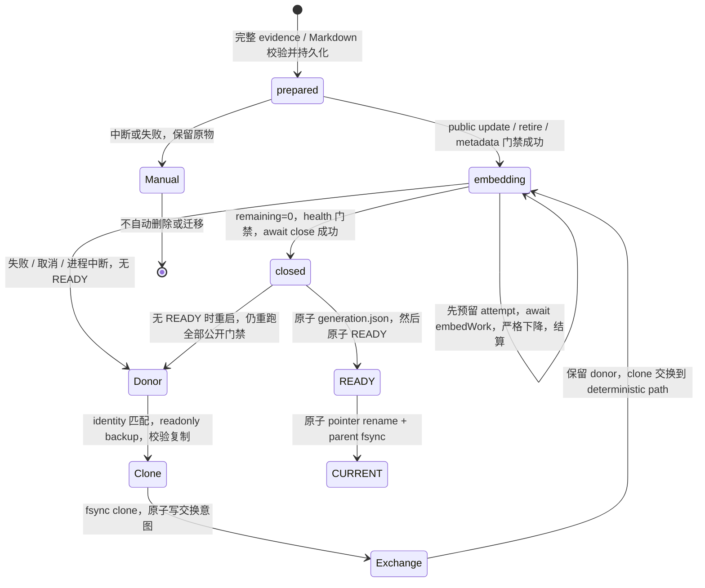

# Embedding checkpoint / donor recovery handoff

2026-11-11，GPT-6.1 Sol medium，独立实施，未委派。实现已完成静态编译和精确依赖 guard，**未执行任何产品、模型或测试，真实恢复尚未验收**。没有下载模型、读取密钥或 held-out、打开历史 staging DB、修改已发布 generation。先前真实 54 hashes / 7 单元、24 sources / 85 vectors 复用的结论仍只属于旧冻结，不外推到本版。

## 冻结、准确 scope、raw exit

输入冻结 `embedding-bounded-artifacts-20261111.json` inventory `a4dff2a3fd1f9911e9180f1967229e99da71f1fd00d941e4fba82e8588fdb932`。修改前独立运行 artifact-manifest，21,467 项完全同 hash；副本为 [baseline.json](embedding-recovery-validation/baseline.json)。

新冻结 [embedding-recovery-artifacts-20261111.json](embedding-recovery-artifacts-20261111.json)：21,487 项，inventory SHA-256 **`eac6ee9f96666b01cc109975ea69b3e8e2d7c881c572569943e9e06f1b99e0ad`**；JSON 文件 SHA-256 `a61b734bedd34b83d3170467e017c17d045744078bd5b6524cd017dfc7385b8c`。Node 25.7.0，darwin arm64。没有覆盖旧冻结。收尾再次独立生成全 inventory，全部 21,487 项逐项一致、零 mismatch，raw exit 0；见 [final-freeze-check.json](embedding-recovery-validation/final-freeze-check.json)。

[逐项差异](embedding-recovery-validation/inventory-comparison.json)：新增 20 项、改变 20 项、删除 0。新增 5 个 ingestion 模块及 15 个 dist 产物：

- `embedding-checkpoint.ts`：严格 v1 解码、完整 identity 比较、持久化、attempt 预留/结算；原子写入也供发布和交换意图使用。
- `generation-identity.ts`：从本轮实际源字节独立推导 expected EvidenceStore bundles 与 Markdown 清单，验证实际目录。
- `generation-recovery.ts`：donor clone、复制校验、交换意图和三布局恢复；只在 generation 持有 BUILD.lock 时调用。
- `sqlite-backup.ts`：公开 `DatabaseSync(readOnly)` + `backup()`、输出 fsync，供 published seed 与 donor clone 共用；无 QMD SQL、DB hardlink 或主 DB 文件裸复制。
- `errors.ts`：ingestion 错误边界；仅确认的 signal/typed cancellation 映射 CANCELLED，typed TIMEOUT 映射 EMBEDDING_TIMEOUT，未知异常继续 INTERNAL_ERROR。

修改 4 个已有 ingestion 模块及 11 个对应 dist 产物：generation、qmd-build、embedding-work、settings。CLI、QA、API、session、EvidenceStore、分段/向量算法、package/lock、其他依赖均未改。类型输出中原有 generation API 声明字节不变。

必要依赖调整已在实施前说明：QMD root JS/d.ts 各增加一条既有纯函数 `getEmbeddingFingerprint` 的公开 re-export，才能在第一个 attempt **开始前**绑定实际 fingerprint。同步 patch、四文件 hash inventory、安装器 patch hash；QMD 版本/commit 不变，store.js/store.d.ts 与输入冻结完全相同。patch SHA-256 `d89352ae6b8771bd1cffa931627d863395caff74587a94d5e9b915a6e74da96f`。root JS `f777875f6d71ed8debc78ee7a482438c996dec47e221b8e1672e409cdbac908d`，root d.ts `7ea5673f5b406fe81ac731475c504afd9307ce3556b1842f72b2359a6e63bef3`。settings 另外绑定 root/store 声明、llm.js、patch inventory 和 patch 本身。

[全部 raw exit 与 stdout/stderr](embedding-recovery-validation/rawexit.json)：

| 操作 | raw exit | 说明 |
| --- | --- | --- |
| sealed npm run typecheck（含 installer） | 0 | 最终源码 |
| sealed npm run build | 0 | 最终 dist |
| 四文件隔离 pristine → patch guard | 0 | 从旧独立安装反向还原，逐文件验证 pristine SHA 后应用新 patch |
| 同隔离目录重复 guard | 0 | 精确 after 字节 |
| 共享 guard | 0 | 精确 after 字节 |
| 完整新 artifact-manifest | 0 | 新冻结 |

隔离 guard 位置见 [guard-location.json](embedding-recovery-validation/guard-location.json)；只复制 QMD 四文件和安装 metadata，patch-package 工具使用现有安装的只读链接；没有 npm ci 或 native runtime 验证。早期一次 typecheck raw exit 2（nullable identity），已修复；原始日志保留，其后 typecheck/build 全为 0。原本一次过宽的只读 `find ..` 被中止，raw exit 130，未产生修改。编辑辅助脚本/材料化目录在 `/tmp/clec-recovery-*.py` 和 guard-location 所列目录，不是测试。

## 恢复身份与状态图

取舍先写入 [设计说明](embedding-recovery-design-20261111.md)。使用线性状态机，没有通用任务/重试框架。checkpoint 的 phase、identity 和预算是恢复授权；`BUILDING.id` 与 `embedding-work.json` 的 `resumable:false` 都不授权。



交换意图位于 `generations/.embedding-recovery.json`，绑定 generation id、完整 identity key、clone/retained 唯一 basename 和双方 checkpoint SHA。仅推进以下布局；每个 rename 后 parent fsync，移除意图后再 fsync。READY、未知/损坏身份、CURRENT 损坏、意图歧义一律失败保留。

| deterministic / clone / retained 存在 | 动作 |
| --- | --- |
| 1 / 1 / 0 | donor → retained；clone → deterministic |
| 0 / 1 / 1 | 第二次 rename；覆盖 rename 之间进程崩溃 |
| 1 / 0 / 1 | 校验已完成交换，再退休意图 |
| 其他 | RECOVERY_REFUSED；不删除任何目录 |

意图落盘前失败的孤立 `.resume-*` 保留，不自动回收。意图恢复完成后，本次入口仍可以再创建一个经过验证的 donor clone；这可能多保留一个 donor，不影响预算/身份，不以减少副本为由冒险原地打开 donor。所有 `.donor-*` 和旧 `.failed-*` 保留。恢复开始时 CURRENT 先验证；产品从不自动删除 stale BUILD.lock。

identity 包含 raw intake SHA、canonical manifest SHA、源记录/version/contentHash 摘要、独立推导的 source bundle/section/passage 摘要、精确 Markdown filename/bytes/SHA 清单、source/section/document 数、完整 settings/policy/runtime、QMD implementation/declaration/patch/inventory SHA、embedding 模型路径/URI、实际本地 GGUF SHA、公开 SDK fingerprint。对象 canonical 编码忽略 JSON 不持久化的 undefined 字段，排序键；比对完整结构，而不是仅比较短 fingerprint。

**hybrid 现在要求 `QMD_EMBED_MODEL` 指向可读本地 GGUF。** URI-only HF 无实际 byte hash 会在准备前 RECOVERY_REFUSED，不自动下载/猜缓存位置。rerank/generate 若是本地路径仍沿用已有字节 hash；HF rerank/generate URI 绑定 settings，它们不参与 ingestion embedding。若要 URI-only embedding，应先另行实现并评审可信 artifact 解析，不能放宽身份。

## 预算、文档复用与发布

每次 public SDK 准备/恢复更新、每个 embedWork、最终 health/close 窗口前，checkpoint durable 预留一个 attempt（序号、pendingBefore、最多 min(2h, 剩余总预算)）。await 工作结算后换为实测耗时；崩溃或未知结果在下一 clone checkpoint 中按全部预留额度扣除。累计 24h settings 值跨恢复继承，不按新进程重置。克隆/证据生成验证与进程停机不计入 embedding/SDK 总预算；它们不加载模型。原生操作协作式，必须 await settle，可超时返回后才关闭，不能声称 hard deadline。

原子 checkpoint 和 SQLite 不是一个跨库事务。checkpoint.remaining 可以落后于 DB；恢复取公开 status 的真实 pending（允许下降，禁止相对可信基线增长），不按 unit 序号跳过文档。每进程最多本轮 pending 个非空成功单元，严格减少；历史 successfulUnits 仅统计，不作为累计拒绝阈值。无进展立即拒绝。QMD 既有 strict 文档谓词/局部清理保持原样：完整 hash 复用，partial 整文档重做。

唯一 collection/path、active count、typed source metadata、pendingMetadata、status/health needsEmbedding、vector index/partition 全部门禁保留。QMD close 成功后才写 phase=closed；generation 再校验证据，原子 metadata → READY → CURRENT。generation.json 存在但没有 READY 会走 checkpoint 克隆恢复；closed 无 READY 仍重跑公开门禁，不直接补章。CURRENT 读取错误只有确实 ENOENT 才是 NO_INDEX；空值、坏值、非普通文件或坏 generation 都失败保留。

取消归因：旧 CLI 将 root SDK 的 EmbedWorkError / Node AbortError 送到通用 publicError，所以出现 INTERNAL_ERROR。新 ingestion 边界在 QMD 操作和 close 已完成后识别 typed CANCELLED + 已 abort caller signal，或 caller signal 已 abort 且 cause 链存在 AbortError / ABORT_ERR / 原始 signal.reason。不会仅凭 signal.aborted 把任意异常变成取消。时间错误为 EMBEDDING_TIMEOUT / EMBEDDING_BUDGET_EXHAUSTED，失败始终非零；SDK cleanupError 不改变“整个调用失败”的事实。此归因是源码调查，**尚未真实复现验证新输出**。

## Terra medium 可执行入口（本轮未运行）

所有测试必须由 Terra medium 亲自做真实 E2E，无 mock/unit/component/smoke，不委派、不读取密钥/held-out、不下载模型。只在新隔离 state/workspace 运行；不要重启或迁移历史无 checkpoint 的取消 staging。以下命令是交接指令，不是运行记录；每条产品命令分别保存 stdout/stderr/raw exit、时间、CURRENT 前后与完整 checkpoint/目录布局。

```sh
cd /Users/century/vibing/clec
RECOVERY_ROOT=$(mktemp -d /tmp/clec-recovery-terra-20261111-XXXXXX)
mkdir -p "$RECOVERY_ROOT/state" "$RECOVERY_ROOT/logs"
node backend/scripts/artifact-manifest.ts "$RECOVERY_ROOT/shared-preflight.json"
# 核对 inventory 必须为 eac6ee9f96666b01cc109975ea69b3e8e2d7c881c572569943e9e06f1b99e0ad
rsync -a --exclude node_modules --exclude dist backend/ "$RECOVERY_ROOT/backend/"
cp -R /tmp/clec-bounded-terra-20261111/workspace "$RECOVERY_ROOT/workspace"
cp /tmp/clec-bounded-terra-20261111/state/intake.json "$RECOVERY_ROOT/state/intake.json"
cp /tmp/clec-bounded-terra-20261111/state/cancel.json "$RECOVERY_ROOT/state/cancel.json"
cd "$RECOVERY_ROOT/backend"
NODE_LLAMA_CPP_SKIP_DOWNLOAD=true HUSKY=0 CI=true npm ci --no-audit --no-fund
npm run postinstall
npm run typecheck
npm run build
export CLEC_WORKSPACE="$RECOVERY_ROOT/workspace"
export CLEC_STATE_DIR="$RECOVERY_ROOT/state"
export CLEC_PI_DIR="$RECOVERY_ROOT/pi"
export QMD_EMBED_MODEL=/Users/century/.cache/clec/models/Qwen3-Embedding-0.6B-Q8_0.gguf
export QMD_RERANK_MODEL=/Users/century/.cache/clec/models/qwen3-reranker-0.6b-q8_0.gguf
# 用 env -u 保证本次产品子进程不继承 DeepSeek 凭据，不打印环境。
env -u DEEPSEEK_API_KEY /usr/bin/time -p node dist/cli.js build "$RECOVERY_ROOT/state/intake.json" --hybrid
# 下面 build 在真实 observer 控制下启动，不能先无条件跑完再声称观察到取消。
env -u DEEPSEEK_API_KEY /usr/bin/time -p node dist/cli.js build "$RECOVERY_ROOT/state/cancel.json" --hybrid
# 等待真正退出并保留 raw exit 后，对完全相同命令显式再运行，即恢复入口。
env -u DEEPSEEK_API_KEY /usr/bin/time -p node dist/cli.js build "$RECOVERY_ROOT/state/cancel.json" --hybrid
env -u DEEPSEEK_API_KEY node dist/cli.js status
```

先确认历史模型文件及语料仍存在；没有则报告缺失，不下载/替换。独立 npm ci 的 node_modules metadata 可能与共享安装不同；单独保留其 inventory 并核对全部源码、dist、四个精确 guarded QMD 文件，不能虚报完整树逐字节一致。production omit-dev 另开隔离安装，不能改共享依赖。

真实门禁：

1. 新版小库成功构建与真实 hybrid 检索；唯一 active collection、pending=0、typed metadata、health、READY/CURRENT、close 成功。重新证明 24 来源/54 hashes/7 单元等真实数值，不能沿用旧报告。
2. 在新增真实来源的构建中等待至少一个真实成功单元及随后 active reservation，再发 SIGINT；记录 CPU/native 栈与准确时间、非零 raw exit、CANCELLED、settlement、无 READY、旧 CURRENT 可读。不能把“信号前曾在 native”当成信号时 native 仍在途。
3. 完全相同输入/模型/策略显式重启。保留 donor inode/字节/目录证据、公开 backup 使用证据、实际 pending/新增 vectors、所有 checkpoint 序号和预算；完整 hash 无重复嵌入，partial 文档整篇重做，最终严格门禁与原子发布。不能只看账本成功序号判复用。
4. 另开真实构建窗口 SIGKILL，确认原 owner 及全部子进程已结束。产品再次运行应 BUILD_LOCKED；**人工确认并处理这个确切 stale lock 后**再恢复，证明 unknown reservation 全额扣除，attempt 不回退、24h 不重置。不得编写自动删 stale lock 的产品逻辑或通用清理脚本。
5. 真实进程中观察/中断到交换 rename 窗口，分别验证三布局的实际恢复；不造 SDK 返回、不加产品 fault-injection 开关。未能自然命中就标 NOT_EXERCISED。意图身份错/歧义须失败保留；损坏 CURRENT 不得启动新 build。
6. 在额外隔离状态副本上，用真实不同源字节、模型字节、policy 或 Markdown 验证旧 checkpoint 不被误复用。输入变化可能产生新 generation id，应检查旧 donor 未迁移/未打开；同路径 checkpoint 或实际 Markdown 被破坏必须拒绝恢复。旧无 checkpoint staging 不得导入。
7. 剩余不足一个完整单元时应传入剩余 duration；无进展、byte/chunk 超限、超时、callback/DB/cleanup、close 失败仅在真实可观察条件下记录，没有观察就留 NOT_EXERCISED。不可伪造24h账本或 SDK 结果来充当真实预算验收；代码静态检查不等于24h真实验收。
8. 再由主审安排完整 6,775 来源/30,565 文档、unchanged 零新增、增删改/provenance、原生命周期与冷/热性能、45 题及协议语义回归。held-out 封存。小库和静态验证都不代表最终验收。

所有原文、已发布 generation、历史 freeze/报告/原始日志保留。本实施没有大型依赖算法或向量布局改造；上述真实门禁仍全部待 Terra。
